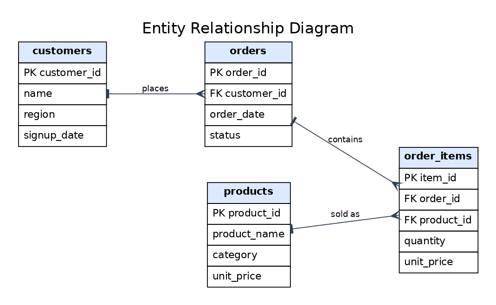

# SQL Business Analytics

  

A relational sales database (SQLite) loaded from raw CSVs, plus a set of SQL queries that answer the questions a business actually asks: revenue trends, top customers, category and region performance, fulfillment health, repeat purchase behavior and cohort value.

Built to show practical SQL for analytics: multi-table joins, aggregations, CTEs, subqueries, date functions and eight window-function queries (running totals, LAG, RANK, NTILE, ROW_NUMBER, FIRST_VALUE, moving averages), all runnable end to end with one command.

## The data

Four tables built from generated CSVs (1,200 customers, 25 products, 2,187 orders, 3,330 line items over 2024-2025):



```
customers (customer_id, name, region, signup_date)
products  (product_id, product_name, category, unit_price)
orders    (order_id, customer_id, order_date, status)
order_items (item_id, order_id, product_id, quantity, unit_price)
```

## Business questions answered

| Query | Question |
| --- | --- |
| `01_monthly_revenue.sql` | How does delivered revenue trend month over month? |
| `02_top_customers.sql` | Who are the top 10 customers by lifetime revenue? |
| `03_category_performance.sql` | Which categories drive revenue and units sold? |
| `04_region_analysis.sql` | How do regions compare on revenue and average order value? |
| `05_repeat_purchase_rate.sql` | What share of customers ordered more than once? |
| `06_cancel_return_rates.sql` | How healthy is fulfillment (delivered / shipped / cancelled / returned)? |
| `07_top_products.sql` | Which products sell the most units? |
| `08_customer_cohort_revenue.sql` | Do older signup cohorts spend more per customer? |
| `09_running_total_revenue.sql` | Cumulative revenue and each month's share of the total *(window: SUM OVER)* |
| `10_mom_growth.sql` | Month-over-month growth and a 3-month moving average *(LAG, moving AVG)* |
| `11_top_products_per_category.sql` | Top 3 products inside every category *(RANK PARTITION BY)* |
| `12_customer_spend_deciles.sql` | How concentrated is revenue across customer deciles? *(NTILE)* |
| `13_days_between_orders.sql` | How long between a repeat customer's orders? *(LAG PARTITION BY)* |
| `14_first_and_latest_order.sql` | First order, latest order and lifetime per customer *(ROW_NUMBER)* |
| `15_region_share_and_rank.sql` | Region rank, share and gap to the leader *(RANK, FIRST_VALUE)* |
| `16_customer_retention_by_quarter.sql` | What share of customers stay active quarter to quarter? *(self-join, LAG)* |

## Headline results

- **Electronics** is 51% of delivered revenue; Books just 4.5%
- **Cairo** leads on revenue (1.64M EGP) but **Alexandria** has the highest average order value (2,863 EGP)
- **64%** of customers are repeat buyers
- Fulfillment: 78.6% delivered, 5.2% cancelled, 3.9% returned
- **Revenue is concentrated:** the top 20% of customers (deciles 1-2) bring 51% of delivered revenue, the bottom 20% just 2.4%
- Quarter-to-quarter retention is low, 13% to 22%, so repeat purchase is driven by returning customers rather than a sticky active base
- Cairo holds 37% of delivered revenue; the gap from Cairo to the next region (Alexandria) is about 746K EGP

Full result tables in [results/](results/).

## Project structure

```
sql-business-analytics/
├── data/                    # source CSVs (synthetic, reproducible)
├── database/sales.db        # built SQLite database
├── queries/                 # one .sql file per business question (16)
├── docs/erd.png             # entity relationship diagram
├── tests/test_queries.py    # every query runs; invariants checked (pytest)
├── results/                 # query output CSVs
├── src/
│   ├── generate_data.py     # regenerates the CSVs (fixed seed)
│   ├── build_db.py          # schema + CSV loader
│   └── run_queries.py       # runs all queries, exports results
└── requirements.txt
```

## Run it

```bash
pip install -r requirements.txt
python src/generate_data.py   # optional: CSVs are included
python src/build_db.py        # build database/sales.db
python src/run_queries.py     # run every query in queries/
python -m pytest tests -q     # 21 tests
```

## Tools

SQL (SQLite), Python, Pandas

## Note on the data

The dataset is synthetic, generated with a fixed random seed so every number above reproduces exactly. The schema mirrors a standard e-commerce export, so pointing `build_db.py` at real CSVs with the same columns needs no code changes.

## Author

Hassan Ashraf - [github.com/Hassan3443](https://github.com/Hassan3443)
